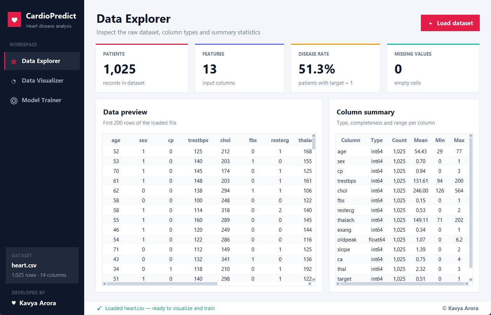
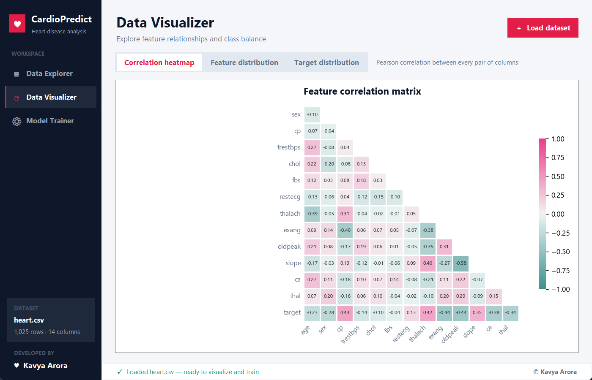
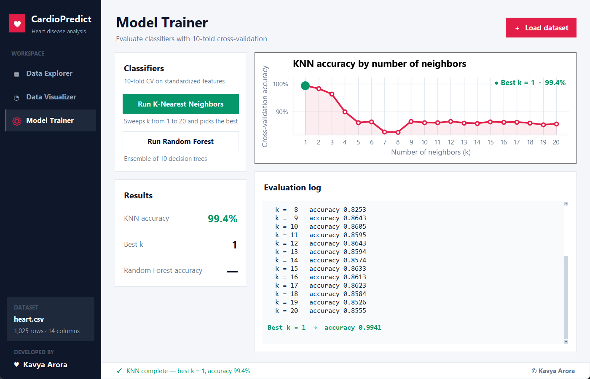

## ❤️ Heart Disease Prediction Analysis


A beautiful and intuitive **AI-Powered Medical Analysis System** for predicting heart disease using machine learning algorithms. This desktop application features a modern GUI built with Tkinter and employs multiple ML models including K-Nearest Neighbors (KNN) and Random Forest classifiers.

## 📸 Screenshots

### Main Interface



### Data Visualization



### Model Training



## ✨ Features

### 📊 **Data Explorer**

- 📂 Load CSV datasets with file dialog
- 📈 View comprehensive dataset statistics
- 🔍 Inspect data types and information
- ✅ Automatic data preprocessing and normalization

### 📉 **Data Visualizer**

- 🔥 **Correlation Heatmap** - Visualize feature relationships
- 📈 **Feature Distribution** - Histogram analysis of all features
- 🎯 **Target Distribution** - Class balance visualization
- 🎨 Modern, professional chart styling

### 🧠 **Model Trainer**

- 🔍 **K-Nearest Neighbors (KNN)** - Test multiple K values (1-20)
- 🌳 **Random Forest Classifier** - Ensemble learning approach
- 📊 10-fold cross-validation for robust evaluation
- 📈 Real-time performance visualization

### 🎨 **Modern UI/UX**

- 💎 Card-based dashboard design with summary stat cards
- 🧭 Sidebar navigation with a persistent "Load dataset" action
- 📐 Resizable layout — charts reflow to fit the window
- ✨ Hover effects and a live status bar
- 🎨 Consistent chart styling (teal = no disease, rose = disease)

## 🚀 Getting Started

### Prerequisites

- Python 3.8 or higher
- pip package manager
- Tkinter (bundled with Python on Windows and macOS; on Ubuntu/Debian install it with `sudo apt install python3-tk`)

### Installation

1. **Clone the repository**

   ```bash
   git clone https://github.com/professionalman/Heart_disease_prediction.git
   cd Heart_disease_prediction
   ```

2. **(Optional) Create a virtual environment**

   ```bash
   python -m venv venv
   venv\Scripts\activate       # Windows
   source venv/bin/activate     # macOS / Linux
   ```

3. **Install required packages**

   ```bash
   pip install -r requirements.txt
   ```

4. **Run the application**

   ```bash
   python Heart_.py
   ```

   On macOS / Linux use `python3` if `python` points to Python 2.

5. **Load the sample data**: click **＋ Load dataset** and pick `heart.csv` from the project folder.

## 📋 Dataset Requirements

The application expects a CSV file with the following features:

| Feature    | Description                       | Type        |
| ---------- | --------------------------------- | ----------- |
| `age`      | Age in years                      | Integer     |
| `sex`      | Sex (1 = male, 0 = female)        | Binary      |
| `cp`       | Chest pain type (0-3)             | Categorical |
| `trestbps` | Resting blood pressure (mm Hg)    | Integer     |
| `chol`     | Serum cholesterol (mg/dl)         | Integer     |
| `fbs`      | Fasting blood sugar > 120 mg/dl   | Binary      |
| `restecg`  | Resting ECG results (0-2)         | Categorical |
| `thalach`  | Maximum heart rate achieved       | Integer     |
| `exang`    | Exercise induced angina           | Binary      |
| `oldpeak`  | ST depression induced by exercise | Float       |
| `slope`    | Slope of peak exercise ST segment | Categorical |
| `ca`       | Number of major vessels (0-4)     | Integer     |
| `thal`     | Thalassemia (0-3)                 | Categorical |
| `target`   | Heart disease (1) or not (0)      | Binary      |

### Sample Dataset

A sample dataset (`heart.csv`) with 1,025 patient records is included in the project folder.

## 🛠️ Technologies Used

### Core Technologies

- **Python 3.x** - Programming language
- **Tkinter** - GUI framework
- **NumPy** - Numerical computing
- **Pandas** - Data manipulation and analysis
- **Matplotlib** - Data visualization
- **Seaborn** - Statistical data visualization

### Machine Learning

- **Scikit-learn** - ML algorithms and tools
  - K-Nearest Neighbors (KNN)
  - Random Forest Classifier
  - StandardScaler for normalization
  - Cross-validation scoring

## 📖 How to Use

### 1️⃣ Load Dataset

1. Open the application
2. Click **"＋ Load dataset"** in the top-right corner (available on every page)
3. Select your CSV file (e.g. `heart.csv`)
4. The **Data Explorer** page shows summary cards, a data preview and a per-column summary

### 2️⃣ Visualize Data

1. Open **Data Visualizer** from the sidebar
2. Choose a chart from the switcher at the top:
   - **Correlation Heatmap** - See feature correlations
   - **Feature Distribution** - Analyze feature patterns
   - **Target Distribution** - Check class balance

### 3️⃣ Train Models

1. Open **Model Trainer** from the sidebar
2. Click **"Run K-Nearest Neighbors"** to test the KNN classifier
   - Evaluates K values from 1 to 20
   - Displays performance graph
   - Shows optimal K value
3. Click **"Run Random Forest"** to test the RF classifier
   - Shows cross-validation score
   - Displays accuracy percentage

## 🎯 Model Performance

### K-Nearest Neighbors (KNN)

- **Algorithm**: Instance-based learning
- **Evaluation**: 10-fold cross-validation
- **Parameters**: K values from 1 to 20
- **Output**: Performance graph and optimal K value

### Random Forest

- **Algorithm**: Ensemble learning (10 trees)
- **Evaluation**: 10-fold cross-validation
- **Output**: Average accuracy score

## 📁 Project Structure

```
Heart_disease_prediction/
│
├── Heart_.py                 # Main application file
├── README.md                 # Project documentation
├── requirements.txt          # Python dependencies
├── heart.csv                 # Sample dataset (1,025 records)
├── .gitignore
│
└── screenshots/              # Application screenshots
    └── Picture1.png … Picture7.png
```

## 🔧 Configuration

The application uses these default settings:

- **Window Size**: 1400x900 pixels (minimum 1100x720, resizable)
- **Theme**: Modern flat design with a dark sidebar
- **Colors** (defined in the `C` dictionary at the top of `Heart_.py`):
  - Accent: `#E11D48` (Rose)
  - Success: `#059669` (Green)
  - Healthy class: `#14B8A6` (Teal)
  - Sidebar: `#0F172A` (Slate)
- **Font**: Segoe UI

## 🤝 Contributing

Contributions are welcome! Here's how you can help:

1. Fork the repository
2. Create a feature branch (`git checkout -b feature/AmazingFeature`)
3. Commit your changes (`git commit -m 'Add some AmazingFeature'`)
4. Push to the branch (`git push origin feature/AmazingFeature`)
5. Open a Pull Request

## 📝 Future Enhancements

- [ ] Add more ML algorithms (SVM, Neural Networks, etc.)
- [ ] Implement model comparison dashboard
- [ ] Add prediction feature for new patients
- [ ] Export model results to PDF/CSV
- [ ] Add data preprocessing options
- [ ] Implement feature importance analysis
- [ ] Add confusion matrix visualization
- [ ] Support for more dataset formats (Excel, JSON)
- [ ] Add dark mode theme
- [ ] Implement model saving/loading

## 🐛 Known Issues

- None currently reported

## 📄 License

This project is licensed under the MIT License - see the [LICENSE](LICENSE) file for details.

## 👨‍💻 Author

**Kavya Arora**

- GitHub: [Kavya Arora](https://github.com/professionalman)
- Email: 24mca20091@cuchd.in

## 🙏 Acknowledgments

- UCI Machine Learning Repository for the heart disease dataset
- Scikit-learn documentation and community
- Python data science community
- All contributors and testers

## 📧 Contact

For questions, suggestions, or issues, please open an issue on GitHub or contact the author directly.

---

<p align="center">
  Made with ❤️ and Python
</p>

<p align="center">
  <sub>Built as part of MCA SEM 3 Machine Learning Project</sub>
</p>
